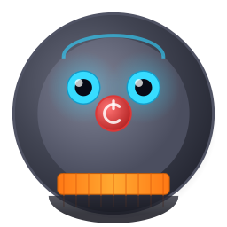

  
  

  # 🤖 Masaüstü Robot Süpürge

  **Dağınık masaüstünüzü saniyeler içinde, eğlenceli bir animasyonla temizleyen akıllı asistan.**

  
  
  

---

## ✨ Özellikler
- 🧹 **Akıllı Kategorizasyon:** Dosyalarınızı uzantılarına göre otomatik tanır.
- ⚙️ **Modern ve Şık Arayüz:** Pürüzsüz animasyonlara sahip karanlık (Dark Mode) kontrol paneli.
- 💬 **Eğlenceli Animasyon:** Temizlik sırasında dosyaları yiyerek konuşan masaüstü robot animasyonu.
- 🎯 **Özel Kurallar:** Hangi dosya türünün **Taşınacağını**, **Silineceğini** veya **Atlanacağını** tamamen siz belirlersiniz.

## 🚀 İndirme ve Kurulum
1. GitHub **Actions** veya **Releases** sekmesinden `main.exe` dosyasını indirin.
2. Çift tıklayıp çalıştırın.
3. Sağ üstteki **`⚙ Ayarlar`** menüsünden kurallarınızı belirleyin.
4. **`▶ Süpür`** butonuna basın ve robotun masaüstünüzü temizlemesini izleyin!
